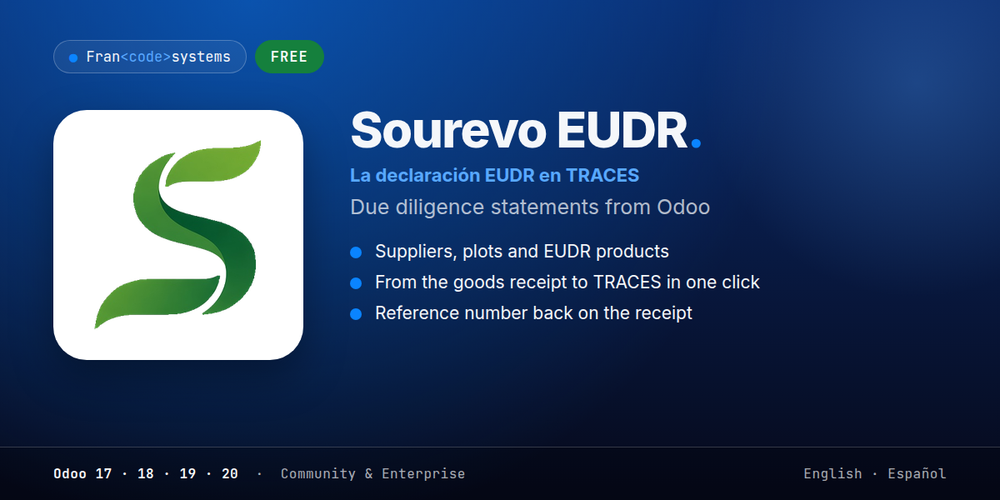
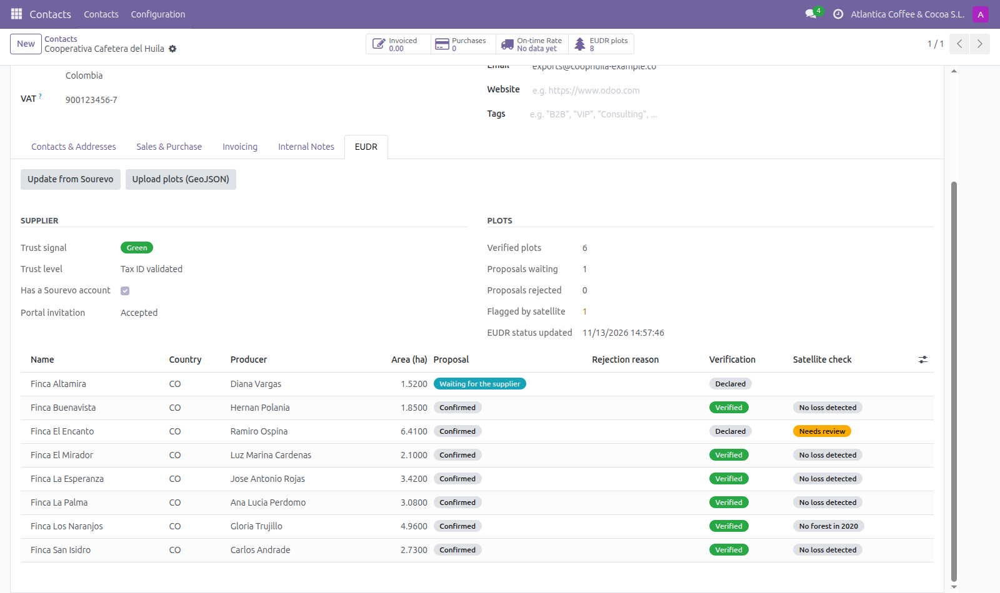
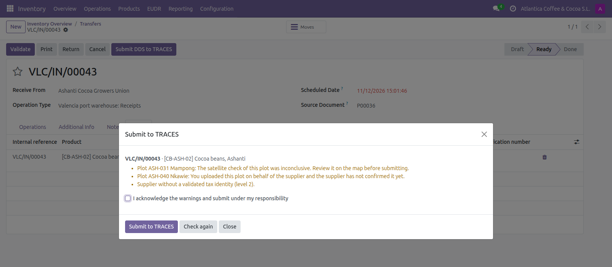
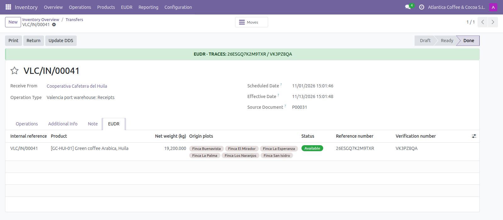

# Sourevo EUDR for Odoo

**Submit EUDR due diligence statements to EU TRACES straight from your Odoo goods receipts.**



`sourevo_eudr` connects Odoo Inventory and Purchase with [Sourevo](https://sourevo.com/en), the EUDR
compliance service that submits due diligence statements (DDS) to TRACES through its official API. You
prepare the statement from the receipt, review the warnings, submit, and the TRACES reference and
verification numbers come back to the receipt, ready for customs.

The module is free. It needs a Sourevo account with API access (see [Requirements](#requirements)).

## Why

Under the EU Deforestation Regulation ([Regulation (EU) 2023/1115](https://eur-lex.europa.eu/eli/reg/2023/1115/oj)),
anyone who places coffee, cocoa, wood, rubber, soy, palm oil or cattle (and products made from them) on
the EU market, or exports them, must first submit a due diligence statement in TRACES: the product and
quantity, the geolocation of every plot of land where it was produced, and the risk assessment. Without
the reference number, the goods do not clear customs.

- **30 December 2026**: large and medium operators.
- **30 June 2027**: micro and small operators.

Most of that data already lives in Odoo: the supplier, the product and its CN code, the net weight of the
receipt. This module sends it to Sourevo and brings the result back.

## Features

- **Settings**: Sourevo API key, connection test (organization, plan and mode), signed webhooks with one
  click, and the default company, role and activity that submit in TRACES.
- **EUDR products**: EUDR flag and 8-digit CN code on the product; scientific and common name for wood,
  pulp and paper; supplementary unit when the CN code has one.
- **Suppliers**: send them to Sourevo, invite them to their own portal, and see their trust level, their
  plots and the satellite check of each plot on the contact.
- **Plots**: upload a GeoJSON file (Point, Polygon or MultiPolygon, WGS84) as proposals the supplier
  confirms, corrects or rejects in its portal. Cattle establishments are supported.
- **Receipts**: one statement per EUDR product with its net weight, harvest dates and plots; a
  pre-submission check with blocking issues and warnings; submission to TRACES; reference and
  verification numbers on the receipt, in the transfer list and on the printed receipt.
- **Kept in sync**: TRACES statuses (available, rejected, withdrawn, suspended, updated...) arrive by
  webhook, or through a scheduled action every 15 minutes when Odoo is not reachable from the internet.
  The plots of a statement already in TRACES can be amended from Odoo.
- **Activities** when a plot is rejected or flagged by the satellite check, or a statement is rejected,
  withdrawn or suspended.
- **Safe to retry**: every request carries an idempotency key; webhooks are verified with HMAC-SHA256
  and a timestamp.

| Supplier, plots and satellite check | Warnings before submitting |
|---|---|
|  |  |



## What Sourevo does behind it

- Submits, amends and withdraws statements through the official **TRACES API (version 4)**, tested end to
  end in EUDR Acceptance, the official TRACES test environment.
- **Satellite checks** of every plot against the JRC 2020 forest map and Global Forest Watch tree cover
  loss and alerts, with Copernicus Sentinel-2 images from 2020 and from today.
- A free **supplier portal** in 12 languages where producers upload and confirm their plots.
- **Authorised representatives**: forwarders and customs agents submit for several companies.
- The due diligence record of each statement, kept for five years.

## Requirements

- A [Sourevo](https://sourevo.com/en) account. The API is included from the **Pro** plan (also Forwarder
  and Enterprise); packs do not include it. See [pricing](https://sourevo.com/en/pricing).
- During the **14-day free trial** the API works in test mode: statements go to the TRACES test
  environment (or a simulated TRACES) and their numbers have no legal value.
- To submit for real: your company registered in TRACES with Web Services Access, with its credentials
  stored once in Sourevo.
- Odoo 17, 18, 19 or 20, Community or Enterprise, on Odoo.sh or your own server, with `purchase`, `stock`
  and `contacts`. Python package `requests`. Odoo Online cannot install modules with Python code.

## Installation

Download the module from the Odoo Apps Store, or clone the branch of your Odoo version into your addons
path:

```bash
git clone -b 20.0 https://github.com/francodesystems/sourevo-odoo.git
```

Then update the apps list and install **Sourevo EUDR**.

## Configuration

1. In Sourevo, open the **API** menu and create an API key (it starts with `svk_`).
2. In Odoo, go to **Settings > Sourevo**, paste the key and click **Test connection**. The companies that
   submit in TRACES are loaded from Sourevo; choose the default one, its role and activity.
3. Click **Connect notifications** so Sourevo can tell Odoo when TRACES answers. If the database is not
   public, the scheduled action keeps the statements up to date every 15 minutes.
4. Mark your EUDR products (Inventory tab: EUDR, CN code) and send your suppliers to Sourevo.
5. On an incoming receipt, click **Prepare DDS**, then **Submit DDS to TRACES**.

Data sent to Sourevo: nothing until you enter your own API key. Then only what you send: the supplier
(name, country, tax ID, address, email and phone), the product (description and CN code), the plots you
upload and, for each receipt, its net weight and plots.

## Supported versions

| Branch | Odoo | Editions |
|---|---|---|
| [`20.0`](https://github.com/francodesystems/sourevo-odoo/tree/20.0) | 20.0 | Community, Enterprise |
| [`19.0`](https://github.com/francodesystems/sourevo-odoo/tree/19.0) | 19.0 | Community, Enterprise |
| [`18.0`](https://github.com/francodesystems/sourevo-odoo/tree/18.0) | 18.0 | Community, Enterprise |
| [`17.0`](https://github.com/francodesystems/sourevo-odoo/tree/17.0) | 17.0 | Community, Enterprise |

The user interface is in English, with translations in `i18n/` for Spanish, French, Portuguese, German,
Italian, Dutch and Polish.

## Development

```bash
docker compose -p sourevo-odoo -f dev/docker-compose.yml up -d    # Odoo of this branch on http://localhost:8179
dev/odoo.sh -d test -i sourevo_eudr --stop-after-init
dev/odoo.sh -d test -u sourevo_eudr --test-tags /sourevo_eudr --stop-after-init
```

The tests never call Sourevo: they mock the API with the responses of its OpenAPI specification. To try
it for real, use an `svk_` key of a test organization in Settings > Sourevo (and
`http://host.docker.internal:3200/api/v1` as the API URL for a Sourevo running on your machine).
`dev/port.py` ports a change from one Odoo version to the next one down.

The store page (`static/description/index.html`) and the cover are generated by
`fds-odoo-apps/scripts/store_page.py` and `store_cover.py` from `scripts/store_pages/sourevo_eudr.py`.

API reference for other integrations: [sourevo.com/en/developers](https://sourevo.com/en/developers)
(OpenAPI at `https://sourevo.com/api/v1/openapi.json`).

## Support

Made and maintained by [Francodesystems](https://francodesystems.com), the company behind Sourevo.
Questions, setup help or bugs: [juan.canton@sourevo.com](mailto:juan.canton@sourevo.com)
or a [GitHub issue](https://github.com/francodesystems/sourevo-odoo/issues).

## License

[Odoo Proprietary License v1.0 (OPL-1)](https://www.odoo.com/documentation/master/legal/licenses.html#odoo-apps).
